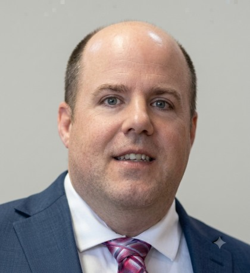

### Daniel Anthony Fitzgerald

Fredericton, NB, Canada — software & data engineer. I build things for work and for fun. Most of what I make is live on the web, so the sites and demos below are the front door; code is linked where it's public.

By day I'm a Senior Data Engineer at [Climative](https://climative.ai), working on data platforms covering homes and buildings across Canada and the US — pipelines, data quality, and the APIs other teams build on. Before tech I spent years as a research scientist (50+ peer-reviewed publications), so I tend to bring a measurement habit to engineering problems.

Off the clock I run [Crustacean Software](https://crustaceansoftware.ca), edit [NB Tech News](https://nbtechnews.ca), and volunteer around Fredericton.

## Live work

**[NB Tech News](https://nbtechnews.ca)** — a New Brunswick tech newsroom I founded and edit: reported coverage of the province's tech sector, university research, and data-centre fights. *(Production code is private.)*

**[MVT Fredericton](https://www.mvtfredericton.ca)** · [gameplay demo & write-up](https://crustaceansoftware.ca/demos/mvt-fredericton) — an open-world, GTA-style game set in a real-data Fredericton, built in Godot, with a browser version you can play right now. Published by FUKD Entertainment. *(Production code is private.)*

**[Crustacean Software](https://crustaceansoftware.ca)** — my studio site and demo shelf: interactive "tide pool" demos of the things I build, including MVT Fredericton and Plan 2026.

**[plan2026](https://plan2026.ca)** · [code](https://github.com/danfour649/plan2026) — a hobby project that got out of hand: a full-stack planning app (Next.js, PostgreSQL), live in English, French, and Nigerian Pidgin.

**[maps-of-nb](https://maps-of-nb.vercel.app)** · [code](https://github.com/danfour649/maps-of-nb) — New Brunswick open map data (GeoNB orthophotos, LiDAR buildings, roads) with an interactive Fredericton viewer; the data pipeline behind MVT Fredericton's maps.

**[Pigin Translator](https://pigin-translator.vercel.app)** · [code](https://github.com/danfour649/pigin-translator) — English to Nigerian Pidgin and Yoruba translator (TypeScript), spun out of plan2026's Pidgin work. Open source (MIT).

**[Galaga-assembly](https://danfour649.github.io/Galaga-assembly/)** · [code](https://github.com/danfour649/Galaga-assembly) — a Galaga-style arcade clone with its gameplay core in x86-64 assembly (NASM) and a portable C/SDL2 build compiled to WebAssembly. Works on phones with touch controls.

**Previously** — Software Engineer II at Cvent · Developer at Accreon · Research Specialist at the University of Illinois at Chicago.

## Connect

[LinkedIn](https://www.linkedin.com/in/danfitzg/) · [Crustacean Software](https://crustaceansoftware.ca) · [Google Scholar](https://scholar.google.com/citations?user=zl0ceKAAAAAJ&hl=en) · [Email](mailto:danfour@gmail.com)
