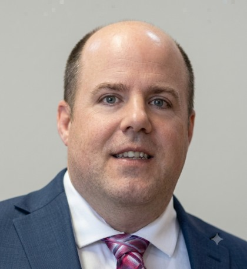

### Daniel Anthony Fitzgerald

Fredericton, NB, Canada — software & data engineer. I build things for work and for fun.

By day I'm a Senior Data Engineer at [Climative](https://climative.ai), working on data platforms covering homes and buildings across Canada and the US — pipelines, data quality, and the APIs other teams build on. Before tech I spent years as a research scientist (50+ peer-reviewed publications), so I tend to bring a measurement habit to engineering problems.

Off the clock I edit [NB Tech News](https://nbtechnews.ca) and volunteer around Fredericton.

## Featured projects

**[plan2026](https://github.com/danfour649/plan2026)** · [plan2026.ca](https://plan2026.ca) — a hobby project that got out of hand: a full-stack planning app (Next.js, PostgreSQL), live in English, French, and Nigerian Pidgin.

**[pigin-translator](https://github.com/danfour649/pigin-translator)** — English to Nigerian Pidgin and Yoruba translator (TypeScript), spun out of plan2026's Pidgin work. Open source (MIT).

**Previously** — Software Engineer II at Cvent · Developer at Accreon · Research Specialist at the University of Illinois at Chicago.

*Most of my production work lives in private repos — the public ones are the fun stuff.*

## Connect

[LinkedIn](https://www.linkedin.com/in/danfitzg/) · [Google Scholar](https://scholar.google.com/citations?user=zl0ceKAAAAAJ&hl=en) · [Email](mailto:danfour@gmail.com)
